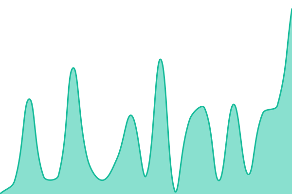
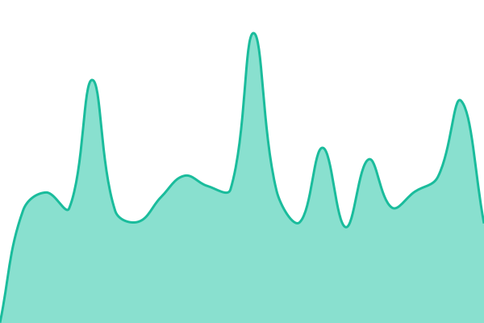
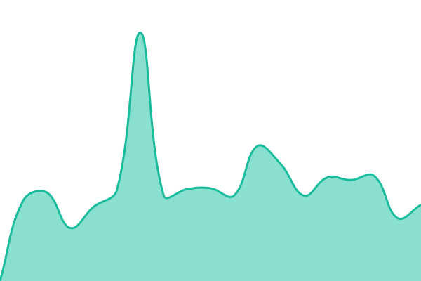
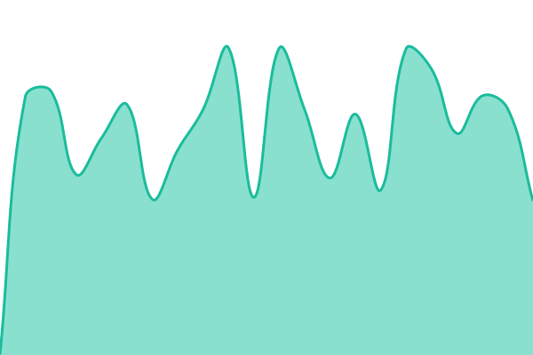
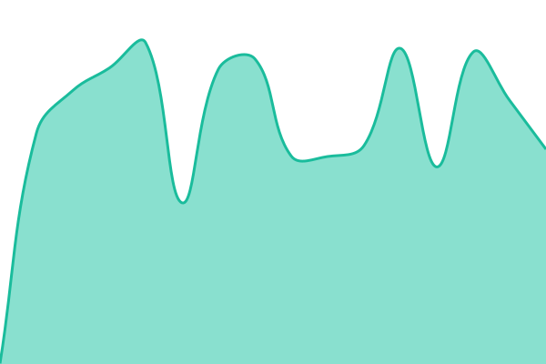
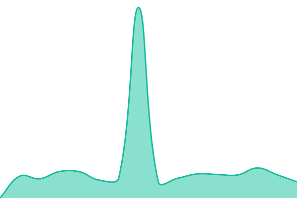
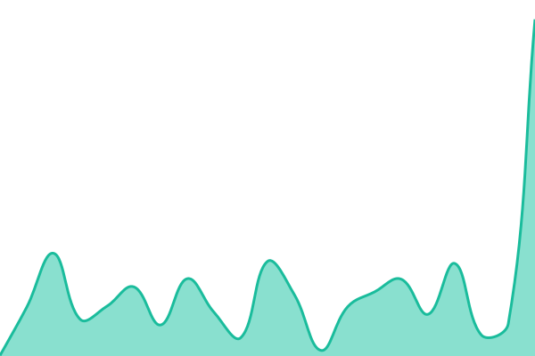

# [📈 Live Status](https://status.homeruntech.io): <!--live status--> **🟧 Partial outage**

This repository contains the open-source uptime monitor and status page for [Homerun Tech](https://status.homeruntech.io), powered by [Upptime](https://github.com/upptime/upptime).

With [Upptime](https://upptime.js.org), you can get your own unlimited and free uptime monitor and status page, powered entirely by a GitHub repository. We use [Issues](https://github.com/homeruntech/upptime/issues) as incident reports, [Actions](https://github.com/homeruntech/upptime/actions) as uptime monitors, and [Pages](https://status.homeruntech.io) for the status page.

<!--start: status pages-->
<!-- This summary is generated by Upptime (https://github.com/upptime/upptime) -->
<!-- Do not edit this manually, your changes will be overwritten -->
<!-- prettier-ignore -->
| URL | Status | History | Response Time | Uptime |
| --- | ------ | ------- | ------------- | ------ |
|  [Armut TR ~ Auth](https://id.armut.com/health_check) | 🟩 Up | [armut-tr-auth.yml](https://github.com/homeruntech/upptime/commits/HEAD/history/armut-tr-auth.yml) | 

 468ms
     
 | 

<a href="https://homeruntech.github.io/upptime/history/armut-tr-auth">98.90%</a>
    

|  [Armut TR ~ Homepage](https://armut.com) | 🟩 Up | [armut-tr-homepage.yml](https://github.com/homeruntech/upptime/commits/HEAD/history/armut-tr-homepage.yml) | 

 137ms
     
 | 

<a href="https://homeruntech.github.io/upptime/history/armut-tr-homepage">98.92%</a>
    

|  [HomeRun CZ ~ Auth](https://id.homerun.co.cz/health_check) | 🟩 Up | [home-run-cz-auth.yml](https://github.com/homeruntech/upptime/commits/HEAD/history/home-run-cz-auth.yml) | 

 810ms
     
 | 

<a href="https://homeruntech.github.io/upptime/history/home-run-cz-auth">98.93%</a>
    

|  [HomeRun CZ ~ Homepage](https://homerun.co.cz) | 🟩 Up | [home-run-cz-homepage.yml](https://github.com/homeruntech/upptime/commits/HEAD/history/home-run-cz-homepage.yml) | 

 472ms
     
 | 

<a href="https://homeruntech.github.io/upptime/history/home-run-cz-homepage">98.95%</a>
    

|  [HomeRun EG ~ Auth](https://id.homerun.com.eg/health_check) | 🟩 Up | [home-run-eg-auth.yml](https://github.com/homeruntech/upptime/commits/HEAD/history/home-run-eg-auth.yml) | 

 507ms
     
 | 

<a href="https://homeruntech.github.io/upptime/history/home-run-eg-auth">98.97%</a>
    

|  [HomeRun EG ~ Homepage](https://homerun.com.eg) | 🟩 Up | [home-run-eg-homepage.yml](https://github.com/homeruntech/upptime/commits/HEAD/history/home-run-eg-homepage.yml) | 

 164ms
     
 | 

<a href="https://homeruntech.github.io/upptime/history/home-run-eg-homepage">98.98%</a>
    

|  [HomeRun HU ~ Auth](https://id.homerun.co.hu/health_check) | 🟩 Up | [home-run-hu-auth.yml](https://github.com/homeruntech/upptime/commits/HEAD/history/home-run-hu-auth.yml) | 

 574ms
     
 | 

<a href="https://homeruntech.github.io/upptime/history/home-run-hu-auth">99.00%</a>
    

|  [HomeRun HU ~ Homepage](https://homerun.co.hu) | 🟩 Up | [home-run-hu-homepage.yml](https://github.com/homeruntech/upptime/commits/HEAD/history/home-run-hu-homepage.yml) | 

 203ms
     
 | 

<a href="https://homeruntech.github.io/upptime/history/home-run-hu-homepage">99.01%</a>
    

|  [HomeRun PL ~ Auth](https://id.homerun.pl/health_check) | 🟩 Up | [home-run-pl-auth.yml](https://github.com/homeruntech/upptime/commits/HEAD/history/home-run-pl-auth.yml) | 

 512ms
     
 | 

<a href="https://homeruntech.github.io/upptime/history/home-run-pl-auth">99.03%</a>
    

|  [HomeRun PL ~ Homepage](https://homerun.pl) | 🟩 Up | [home-run-pl-homepage.yml](https://github.com/homeruntech/upptime/commits/HEAD/history/home-run-pl-homepage.yml) | 

 174ms
     
 | 

<a href="https://homeruntech.github.io/upptime/history/home-run-pl-homepage">99.05%</a>
    

|  [HomeRun RO ~ Auth](https://id.homerun.ro/health_check) | 🟩 Up | [home-run-ro-auth.yml](https://github.com/homeruntech/upptime/commits/HEAD/history/home-run-ro-auth.yml) | 

 560ms
     
 | 

<a href="https://homeruntech.github.io/upptime/history/home-run-ro-auth">99.06%</a>
    

|  [HomeRun RO ~ Homepage](https://homerun.ro) | 🟩 Up | [home-run-ro-homepage.yml](https://github.com/homeruntech/upptime/commits/HEAD/history/home-run-ro-homepage.yml) | 

 215ms
     
 | 

<a href="https://homeruntech.github.io/upptime/history/home-run-ro-homepage">99.08%</a>
    

|  [HomeRun SA ~ Auth](https://id.homerun.com.sa/health_check) | 🟩 Up | [home-run-sa-auth.yml](https://github.com/homeruntech/upptime/commits/HEAD/history/home-run-sa-auth.yml) | 

 667ms
     
 | 

<a href="https://homeruntech.github.io/upptime/history/home-run-sa-auth">99.10%</a>
    

|  [HomeRun SA ~ Homepage](https://homerun.com.sa) | 🟩 Up | [home-run-sa-homepage.yml](https://github.com/homeruntech/upptime/commits/HEAD/history/home-run-sa-homepage.yml) | 

 207ms
     
 | 

<a href="https://homeruntech.github.io/upptime/history/home-run-sa-homepage">99.11%</a>
    

|  [HomeRun UK ~ Auth](https://id.homerun.co.uk/health_check) | 🟩 Up | [home-run-uk-auth.yml](https://github.com/homeruntech/upptime/commits/HEAD/history/home-run-uk-auth.yml) | 

 451ms
     
 | 

<a href="https://homeruntech.github.io/upptime/history/home-run-uk-auth">99.13%</a>
    

|  [HomeRun UK ~ Homepage](https://homerun.co.uk) | 🟩 Up | [home-run-uk-homepage.yml](https://github.com/homeruntech/upptime/commits/HEAD/history/home-run-uk-homepage.yml) | 

 105ms
     
 | 

<a href="https://homeruntech.github.io/upptime/history/home-run-uk-homepage">99.14%</a>
    

|  [ProntoPro AT ~ Auth](https://id.prontopro.at/health_check) | 🟩 Up | [pronto-pro-at-auth.yml](https://github.com/homeruntech/upptime/commits/HEAD/history/pronto-pro-at-auth.yml) | 

 540ms
     
 | 

<a href="https://homeruntech.github.io/upptime/history/pronto-pro-at-auth">99.16%</a>
    

|  [ProntoPro AT ~ Homepage](https://prontopro.at) | 🟩 Up | [pronto-pro-at-homepage.yml](https://github.com/homeruntech/upptime/commits/HEAD/history/pronto-pro-at-homepage.yml) | 

 282ms
     
 | 

<a href="https://homeruntech.github.io/upptime/history/pronto-pro-at-homepage">99.18%</a>
    

|  [ProntoPro CH ~ Auth](https://id.prontopro.ch/health_check) | 🟩 Up | [pronto-pro-ch-auth.yml](https://github.com/homeruntech/upptime/commits/HEAD/history/pronto-pro-ch-auth.yml) | 

 516ms
     
 | 

<a href="https://homeruntech.github.io/upptime/history/pronto-pro-ch-auth">99.20%</a>
    

|  [ProntoPro CH ~ Homepage](https://prontopro.ch) | 🟩 Up | [pronto-pro-ch-homepage.yml](https://github.com/homeruntech/upptime/commits/HEAD/history/pronto-pro-ch-homepage.yml) | 

 196ms
     
 | 

<a href="https://homeruntech.github.io/upptime/history/pronto-pro-ch-homepage">99.21%</a>
    

|  [ProntoPro DE ~ Auth](https://id.prontopro.de/health_check) | 🟩 Up | [pronto-pro-de-auth.yml](https://github.com/homeruntech/upptime/commits/HEAD/history/pronto-pro-de-auth.yml) | 

 494ms
     
 | 

<a href="https://homeruntech.github.io/upptime/history/pronto-pro-de-auth">99.23%</a>
    

|  [ProntoPro DE ~ Homepage](https://prontopro.de) | 🟩 Up | [pronto-pro-de-homepage.yml](https://github.com/homeruntech/upptime/commits/HEAD/history/pronto-pro-de-homepage.yml) | 

 140ms
     
 | 

<a href="https://homeruntech.github.io/upptime/history/pronto-pro-de-homepage">99.24%</a>
    

|  [ProntoPro ES ~ Auth](https://id.prontopro.es/health_check) | 🟩 Up | [pronto-pro-es-auth.yml](https://github.com/homeruntech/upptime/commits/HEAD/history/pronto-pro-es-auth.yml) | 

 436ms
     
 | 

<a href="https://homeruntech.github.io/upptime/history/pronto-pro-es-auth">99.26%</a>
    

|  [ProntoPro ES ~ Homepage](https://prontopro.es) | 🟩 Up | [pronto-pro-es-homepage.yml](https://github.com/homeruntech/upptime/commits/HEAD/history/pronto-pro-es-homepage.yml) | 

 99ms
     
 | 

<a href="https://homeruntech.github.io/upptime/history/pronto-pro-es-homepage">99.28%</a>
    

|  [ProntoPro FR ~ Auth](https://id.prontopro.fr/health_check) | 🟩 Up | [pronto-pro-fr-auth.yml](https://github.com/homeruntech/upptime/commits/HEAD/history/pronto-pro-fr-auth.yml) | 

 471ms
     
 | 

<a href="https://homeruntech.github.io/upptime/history/pronto-pro-fr-auth">99.29%</a>
    

|  [ProntoPro FR ~ Homepage](https://prontopro.fr) | 🟩 Up | [pronto-pro-fr-homepage.yml](https://github.com/homeruntech/upptime/commits/HEAD/history/pronto-pro-fr-homepage.yml) | 

 134ms
     
 | 

<a href="https://homeruntech.github.io/upptime/history/pronto-pro-fr-homepage">99.31%</a>
    

|  [ProntoPro IT ~ Auth](https://id.prontopro.it/health_check) | 🟩 Up | [pronto-pro-it-auth.yml](https://github.com/homeruntech/upptime/commits/HEAD/history/pronto-pro-it-auth.yml) | 

 527ms
     
 | 

<a href="https://homeruntech.github.io/upptime/history/pronto-pro-it-auth">99.33%</a>
    

|  [ProntoPro IT ~ Homepage](https://prontopro.it) | 🟩 Up | [pronto-pro-it-homepage.yml](https://github.com/homeruntech/upptime/commits/HEAD/history/pronto-pro-it-homepage.yml) | 

 171ms
     
 | 

<a href="https://homeruntech.github.io/upptime/history/pronto-pro-it-homepage">99.34%</a>
    

|  [Snowplow collector (Global)](https://collector-snowplow.armut.com/health) | 🟥 Down | [snowplow-collector-global.yml](https://github.com/homeruntech/upptime/commits/HEAD/history/snowplow-collector-global.yml) | 

 407ms
     
 | 

<a href="https://homeruntech.github.io/upptime/history/snowplow-collector-global">100.00%</a>
    

<!--end: status pages-->

[**Visit our status website →**](https://status.homeruntech.io)

## 📄 License

- Powered by: [Upptime](https://github.com/upptime/upptime)
- Code: [MIT](./LICENSE) © [Anand Chowdhary](https://anandchowdhary.com), supported by [Pabio](https://pabio.com)
- Data in the `./history` directory: [Open Database License](https://opendatacommons.org/licenses/odbl/1-0/)
